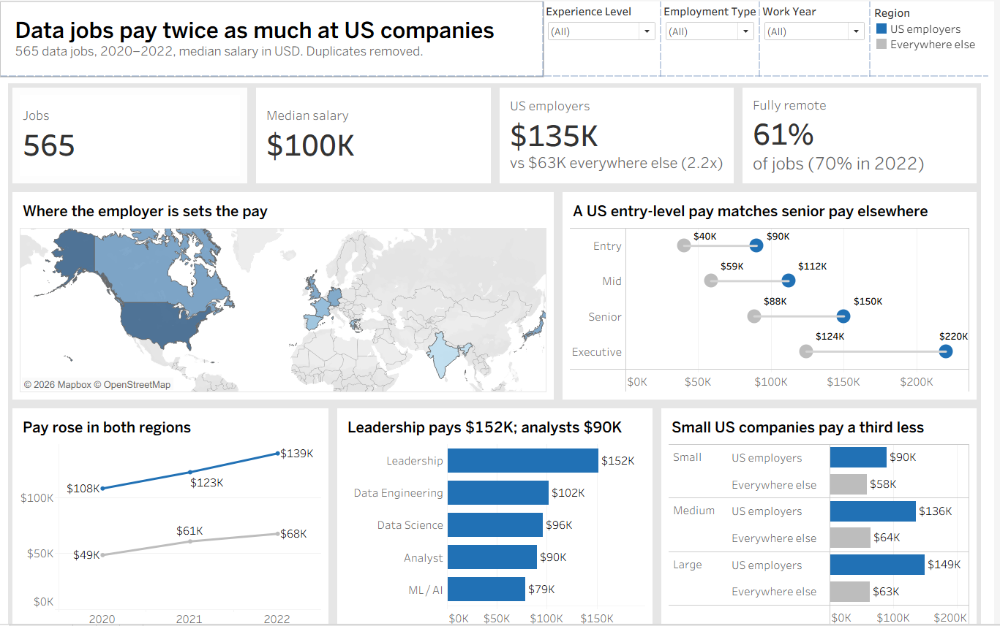

# Data science salaries dashboard (Tableau)

A one-page Tableau Public dashboard on 565 data jobs from 2020 to 2022. It answers a simple question: what actually decides how much a data job pays?

**[View the live dashboard on Tableau Public](https://public.tableau.com/app/profile/sheldon.abraham/viz/DataSalaries_17927175418680/DataSalaries)**



## In short

- Where the employer is matters more than anything else. US companies pay a median $135K, more than twice the $63K everywhere else.
- A US entry-level job pays about what a senior job pays outside the US ($90K against $88K).
- Experience doubles pay, but the gap between the US and everywhere else is there at every level.
- The big jump in 2022 is partly because the 2022 data has many more US jobs in it.

## Why I built it

Salary data is easy to chart badly. Most dashboards on this dataset show average pay by job title or by country, and stop there. But one group, US employers, earns far more than everyone else and makes up over half the rows. That one fact changes most of the other comparisons. I wanted a single page that shows this first, then looks at experience, role, year and company size with it in mind.

## The data

`ds_salaries.csv` is the [Data Science Job Salaries dataset](https://www.kaggle.com/datasets/ruchi798/data-science-job-salaries) from Kaggle. It has 607 rows, one per job, with:

- work year
- experience level
- employment type
- job title
- salary in local currency and converted to US dollars
- where the employee lives
- where the company is
- remote ratio
- company size

**42 rows are exact duplicates**, so the real count is 565 jobs. I removed them before building anything (see below).

## What the dashboard shows

**1. Location sets the pay.**
The map shades each country by median salary, for countries with at least 5 jobs:

| Employer country | Median salary |
| --- | --- |
| US | $135K |
| Canada | $82K |
| UK | $79K |
| Germany | $77K |
| Japan | $76K |
| France | $57K |
| Greece | $49K |
| Spain | $48K |
| India | $22K |

**2. Experience doubles pay, and the US gap stays.**
- **US employers:** entry-level $90K, mid-level $112K, senior $150K, executive $220K
- **Everywhere else:** $40K, $59K, $88K and $124K

So a US entry-level job pays slightly more than a senior job elsewhere.

**3. Pay rose in both regions, but less than the headline suggests.**
The overall median went from $76K in 2020 to $120K in 2022, a 59% rise. Over the same period, US jobs went from 42% of the data to 68%. Looking at each region separately:
- **US:** up 29% ($108K to $139K)
- **Everywhere else:** up 39% ($49K to $68K)

So a large part of the overall jump comes from the mix of jobs changing, not from pay rising.

**4. Leadership is the clear step up.**
By role family:

| Role family | Median salary |
| --- | --- |
| Leadership (leads, managers, heads, directors, principals) | $152K |
| Data engineering | $102K |
| Data science | $96K |
| Analyst | $90K |
| ML / AI | $79K |

ML / AI looks low because more of those jobs are outside the US.

**5. Small US companies pay less.**
- **In the US:** small companies pay $90K, against $136K at medium and $149K at large ones.
- **Outside the US:** company size barely changes pay ($58K–$64K).

**6. Remote work became the norm.**
61% of jobs are fully remote, rising from 50% in 2020 to 70% in 2022.

Remote jobs look better paid overall ($111K against $68K for hybrid), but that's because most hybrid jobs are outside the US. Inside the US, on-site, hybrid and remote pay are all within $120K–$138K.

## Design choices

- **Medians, not averages.** Salaries run from under $3K to $600K, and a few very high ones pull the average up.
- **Two colours, one meaning.** Blue is always US employers and grey is always everywhere else, on every chart.
- **Every title states the finding**, for example "Small US companies pay a third less".
- **Small groups are flagged, not hidden.** Countries with fewer than 5 jobs aren't shaded on the map. Every tooltip shows how many jobs a number is based on.
- **Interactive.** Click a country on the map to filter the whole page. Filters for year, experience level and employment type also apply to everything.

## How I built it

### Cleaning

- Deleted the unnamed row-number column, then removed 42 exact duplicate rows in Excel. Tableau Public can't drop duplicates, and the row numbers made every row look unique. That left 565 jobs.
- Used `salary_in_usd` only. The local-currency salary can't be compared across countries.
- Replaced the short codes with readable names using aliases (SE → Senior, FT → Full-time, M → Medium and so on), and put experience and company size in a logical order.
- Fixed two country codes, GB and ES, that Tableau didn't recognise on the map.

### Calculated fields

There are 9 calculated fields, all listed in [`calculated-fields.md`](calculated-fields.md). Two did most of the work.

**Region.** One field that splits every chart into US employers and everywhere else.
```
Region = IF [company_location] = "US" THEN "US employers" ELSE "Everywhere else" END
```

**Role family.** Groups 50 job titles into 5 families. The order matters: leadership words are checked first, so "Lead Data Analyst" counts as leadership.
```
Role Family =
IF CONTAINS(LOWER([job_title]), "head") OR CONTAINS(LOWER([job_title]), "director")
   OR CONTAINS(LOWER([job_title]), "manager") OR CONTAINS(LOWER([job_title]), "lead")
   OR CONTAINS(LOWER([job_title]), "principal") THEN "Leadership"
ELSEIF CONTAINS(LOWER([job_title]), "analy") THEN "Analyst"
ELSEIF CONTAINS(LOWER([job_title]), "machine") OR CONTAINS(LOWER([job_title]), "ml")
   OR CONTAINS(LOWER([job_title]), "vision") OR CONTAINS(LOWER([job_title]), "nlp")
   OR CONTAINS(LOWER([job_title]), "ai ") THEN "ML / AI"
ELSEIF CONTAINS(LOWER([job_title]), "engineer") OR CONTAINS(LOWER([job_title]), "architect")
   OR CONTAINS(LOWER([job_title]), "etl") OR CONTAINS(LOWER([job_title]), "developer") THEN "Data Engineering"
ELSE "Data Science"
END
```

## Checking the numbers

I checked the dashboard's figures against the raw file in Python.

| Measure | Value |
| --- | --- |
| Jobs (after removing duplicates) | 565 |
| Median salary | $100,000 |
| US employers median | $135,000 |
| Everywhere else median | $62,651 |
| US multiple | 2.2x |
| Fully remote | 61% |
| Median by year (2020 / 2021 / 2022) | $75,544 / $82,528 / $120,000 |

## Limitations

- **It's survey data, not a random sample.** People choose to submit their salary, and over half the jobs are at US companies.
- **Some groups are small.** There are only 26 executive jobs, and 19 part-time, contract or freelance ones. Treat those numbers as rough.
- **Three years only,** and 2022 may not be a full year. The trend line shouldn't be read as a forecast.
- **Currency conversion.** Pay in other currencies was converted to US dollars by the dataset's author, and exchange rates moved over 2020–2022.
- **The role families are my own grouping.** A different grouping would shift the numbers a little.

## What's in this repo

```
├── DataSalaries.twbx            # the Tableau workbook (data included)
├── data/
│   ├── ds_salaries.csv          # original data
│   └── ds_salaries_clean.csv    # duplicates removed (565 rows)
├── calculated-fields.md         # every calculated field
├── images/
│   └── dashboard.png
└── README.md
```

## How to open it

- **Easiest:** use the [live version on Tableau Public](https://public.tableau.com/app/profile/sheldon.abraham/viz/DataSalaries_17927175418680/DataSalaries). Nothing to install.
- **To explore the workbook:** install [Tableau Public](https://www.tableau.com/products/public/download) (free, Windows and Mac) and open `DataSalaries.twbx`.

**Built with:** Tableau Public, Excel, Python (for checking the numbers)

**Sheldon Abraham** · sheldonabraham174@gmail.com
